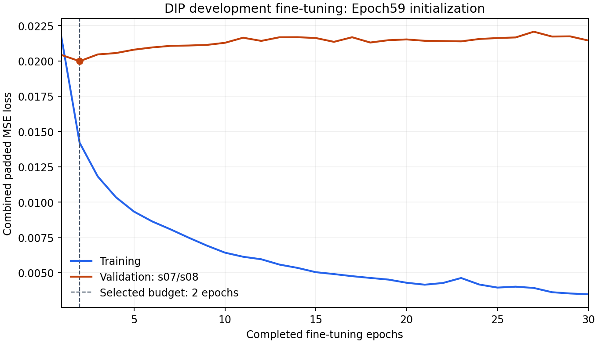

# DIP 开发训练结果与最终训练预算

核查日期：2026-11-15。执行训练：Alex 在普通 WSL Terminal。结果与完整性核查：Codex 协助。

**开发阶段已完成，按冻结规则选出的最终训练预算为 2 epochs。** 下一步从原 AMASS Epoch 59 重新初始化，用 s_01–s_08 固定训练 2 轮，之后才做 s_09/s_10 上同一评估协议的微调前后比较。本次核查没有启动最终训练或测试推理。

## 训练结果

运行目录为 `outputs/local_dip/dip_dev_v1`，run ID `58592e9dbc11470f9990bacb20d6aa9f`。使用 RTX 5060 Ti、cuda:0、batch256、24 个 mask、Adam lr3e-4，按 [冻结协议](protocols/dip_finetuning_v1_20261114/PROTOCOL.json) 完成 30 轮和 1,860 个 optimizer steps。s_01–s_06 训练，s_07/s_08 验证，test 数据未加载。

| 完成轮数 | Training combined loss | Validation combined loss | 解释 |
|---|---:|---:|---|
| 1 | 0.02166910 | 0.02041846 | 开发微调第一轮 |
| 2 | 0.01420470 | **0.01997489** | 全部 30 轮中的最小验证值 |
| 30 | 0.00346574 | 0.02144157 | 最后完成轮；验证值比最优高 7.34% |



训练 loss 继续下降，而独立开发集的最优点很早出现，之后没有更低值，这与过拟合倾向一致。该现象不能单独区分人物域差异、数据规模和输入配置等因素；当前不据此修改已冻结的学习率、mask、损失或选轮规则。

这些数值是包含公开代码 padding 项的 pose＋FK joint MSE，不能当作 cm 单位位置误差，也不能直接比较原 AMASS 的验证损失。四指标改善尚未测量，不从低 training loss 推断论文复现成功。

## 预算选择与完整性

验证项包括：30 条历史顺序完整，step 等于 62×完成轮数；所有 loss 有限；每轮训练有效帧数为 80,070×24，验证有效帧数为 25,423×24；checkpoint 中 20 组 Adam step 均为 1,860；全部 31 个执行源码哈希吻合。完整历史与 last checkpoint 内嵌历史逐项相等。原初始化和冻结协议哈希也保持一致。

| 产物 | 文件 | SHA-256 |
|---|---|---|
| 最佳开发 checkpoint | `checkpoints/epoch_002_03a6585efa03.ckpt` | `4515e13ae95ee5ec49ff90d941c81149ec4c583ba293aadf21abe17de699ba16` |
| 最后开发 checkpoint | `checkpoints/epoch_030_6da9e5d52b29.ckpt` | `298e8580decef1ca2ee9b08370a714116f336a5d652b8919770e30000aa21501` |

最佳 epoch 的内部零起始索引为 1，对应 **2 个完整 epochs**。最终阶段入口已通过 `--check-only` 复核：2 轮、20,736 个训练样本、每轮 81 批、batch256、无开发验证和测试数据加载；预计总更新数为 162。该检查没有构建或更新训练模型，也没有创建最终训练目录。

本轮实际从 2026-11-15 01:56:51 至 02:12:20（America/Chicago）完成，按 RUN 的 UTC 起始时间与 completion 文件时间约为 15 分 29 秒；记录的训练＋验证计算合计 921.19 秒。峰值 PyTorch GPU allocated 为 2,906.05 MiB（不等于全系统 GPU 总占用），进程峰值 RSS 为 2,147.19 MiB。启动时记录 GPU 空闲显存为 6,887 MiB。此次真实执行已验证该设备在当时资源条件下能够运行冻结 batch256 的完整 GPU 前向、反向和更新。

元数据副本：[verification.json](results/dip_dev_v1_20261115/verification.json)、[30 轮历史](results/dip_dev_v1_20261115/history.csv)、[最终阶段只读计划](results/dip_dev_v1_20261115/final_stage_check.json)。完整核查记录与图保存在 `outputs/local_dip/dip_dev_review_20261115/`；原训练记录与 checkpoint 不改写。

## 启动最终前八人训练

在普通 WSL Terminal 执行：

```bash
cd /home/alex/research/PoseEstimationWithWearables

conda run --no-capture-output -n imuposer python -u tools/train_dip_finetuning.py \
  --stage final \
  --device cuda:0 \
  --development-run outputs/local_dip/dip_dev_v1 \
  --output outputs/local_dip/dip_final_v1
```

入口自动读取开发阶段选择的 K=2，重置原 Epoch59、Adam 和 seed42，不需要手工修改 epoch 参数。s_07/s_08 在该阶段按预先约定进入训练；固定预算训练后不再将它们称作独立验证集。最终输出为 `outputs/local_dip/dip_final_v1/final.ckpt`。已有开发目录保持不变；中断时使用同一命令加 `--resume`。

之后才能用固定的最终模型，在相同滚动窗口、平滑、身体模型、24 个 mask 及四指标下评估微调前后。测试结果不用于重新选择本轮 epoch 或 checkpoint。
