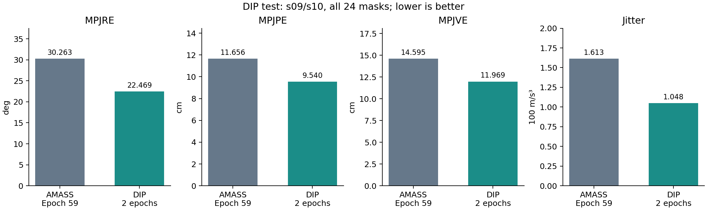

# DIP fine-tuning: four-metric before/after comparison

English presentation updated 2026-11-19; original experiment dates and bytes are preserved in [the language/provenance guide](RECORD_LANGUAGE.md).

Completed: 2026-11-15, America/Chicago. Original AMASS Epoch 59 and final two-epoch DIP models completed identical-protocol evaluation and independent verification. All four aggregate metrics decrease, also in each of24 mask aggregates. Training protocol/checkpoints are unchanged; test scores did not reselect a model.

**2026-11-16 follow-up: **the same final model now has fully audited IMU-only IK: [IMU_ONLY_IK.md](IMU_ONLY_IK.md). Three accuracy errors decrease slightly, jitter rises. This document preserves original no-IK results/protocol; see [current paper alignment](PAPER_EVALUATION_ALIGNMENT.md).

## Main results

| Metric | AMASS Epoch 59 | DIP after2 epochs | Reduction | Improved masks |
|---|---: |---: |---: |---: |
| MPJRE ° | 30.26337 | 22.46870 | 25.76% | 24/24 |
| MPJPE cm | 11.65586 | 9.54019 | 18.15% | 24/24 |
| MPJVE(mesh vertices), cm | 14.59548 | 11.96889 | 18.00% | 24/24 |
| Jitter, 100m/s³ | 1.61320 | 1.04836 | 35.01% | 24/24 |

Coverage: s09/s10, all 19 recordings, 24,078 frames per model/mask, all 24 sparse masks, excluding five-sensor global. Within masks, weight spatial errors by valid frames, jitter by per-recording T−3; then equal24-mask mean. Relative reduction:`(before-after)/before×100%`.

Rotation error drops about 26%, joint/surface errors18%, jitter35%: improved accuracy/smoothness under this fixed evaluation. Jitter is smoothness, not accuracy or GT-relative velocity error. Two subjects and correlated masks do not support statistical significance or broad population generalization.

[Changes CSV](results/dip_final_2ep_20261115/comparison_with_changes.csv) · [Per mask](results/dip_final_2ep_20261115/per_mask.csv) · [Per subject](results/dip_final_2ep_20261115/per_subject.csv) · [Full JSON](results/dip_final_2ep_20261115/metrics.json)

## Model/data provenance

Alex completed `dip_final_v1` in ordinary WSL on RTX5060Ti: first eight subjects, 2 epochs, 162updates, batch 256. Development preselected K=2; final reset to original AMASS weights/fresh Adam/seed42. Training combined loss0.02032563→0.01377506; no test data opened. All 31 execution-source hashes and20 Adam counters verified.

| Model | Fixed weights | SHA-256 |
|---|---|---|
| Before | AMASS Epoch 59 | `02b9211b57ca36ae3fb13dcacc4b008b49a31fd360ebea516b73d103bd2a5058` |
| After | `dip_final_v1/checkpoints/epoch_002_9d8a49a977cb.ckpt` | `996a3e2df21ac675df8f777d975d0700f3836c1d835bb898044a714e6cb5f7d8` |

Test-container SHA-256:`352ce4f1312fbc7d496ce3d3d3c7287f01389624b75296ce4e349868b958b475`. All 19 processed acc/ori/pose recordings bitwise match raw reconstruction: s09 has9, s10 has10.

Actual completed run:`outputs/local_dip/dip_finetune_comparison_cpu_v1/`. Each model577,872 predicted frames, total 1,155,744; all 456 mask×recording pairs complete. GPU training; CPU paired inference/metrics. Codex GPU isolation and user-selected permissions unchanged.

## Fixed measurement

[Actual CPU evaluation protocol](results/dip_final_2ep_20261115/PROTOCOL.json) is separate from [frozen training protocol](protocols/dip_finetuning_v1_20261114/PROTOCOL.json).

| Item | Shared setting |
|---|---|
| Input | 25 Hz, 60D, 24 sparse masks, acc/30 |
| Rolling | 125-history, stride1, last output, short-prefix startup; reset state per window/recording |
| Smoothing | Inherited centered-five acceleration mean, no additional smoothing; disclosed lookahead |
| Network | CPU, FP32, no AMP, eval/inference mode, batch 64; two parallel shards, 8 inference threads each |
| Metrics | Original paper_metrics.py, 2 threads/shard, FKchunk 32; no updates |
| Body | Shared mean male SMPL, 24 joints, 6,890 vertices, pose blend shapes off, zero trajectory |
| MPJRE | FK-global rotation error, degrees; local debug error separate |
| MPJPE/MPJVE | Pelvis translation alignment, joint/vertex cm errors, retain root rotation; MPJVE not velocity |
| Jitter | Predicted joints' third difference ×25³, per-recording; 100m/s³ |
| Reduction/refinement | Frame/T−3 weighting within masks, equal masks; neither model uses IK |

24,021 valid jerk samples/mask. Parallel CPU shards took about 72.2/72.8min, excluding preparation/independent review. Previously prepared ordinary-WSL GPU protocol `dip_finetune_comparison_v1/` had no shared caches/complete results at report time; these results are not mixed with it.

## Validation

- Six new reduction/coverage/weight/input-consistency tests pass; eight synthetic identical static frames give zero actual-SMPL errors. M01 known-pose checks remain applicable.
- Independent audit of955 original artifact hashes, model/SMPL/data/source hashes, 456 caches; targets bitwise match processed data, predictions finite, frame/T−3 denominators correct.
- Independent math.fsum reduction: max difference2.22e-16.
- Predeclared first/last mask ×first/last recording ×two models: eight metric recomputations, FKchunk 32→11, max four-metric difference1.574e-12, below1e-4.
- GT reference jitter identical across masks/models; no retraining, checkpoint changes or test-selected budget.

[Independent audit](results/dip_final_2ep_20261115/independent_validation.json) · [Final training review](results/dip_final_2ep_20261115/FINAL_TRAINING_REVIEW.json) · [Artifact manifest](results/dip_final_2ep_20261115/MANIFEST.json)

## Recalculation and interpretation

Actual entry: [compare_dip_finetuning_cpu.py](../tools/compare_dip_finetuning_cpu.py), reusing [compare_dip_finetuning.py](../tools/compare_dip_finetuning.py) frozen pairing/reduction. Shards `--part 0`/`--part 1` resume the same directory. [validate_dip_finetuning_comparison.py](../tools/validate_dip_finetuning_comparison.py) performs no network inference/model selection. [paper_metrics.py](../tools/paper_metrics.py)/[window_inference.py](../tools/window_inference.py) unchanged.

This establishes same-protocol comparison of the locked final model and initialization. Historical25-mask AMASS exposure, unrecovered author window/startup details, centered filtering/filling/interpolation lookahead, and no IK in this dated baseline remain differences. Do not claim strict reproduction of final paper numbers. Refinement/remaining alignment follow; test results do not alter this frozen budget.
