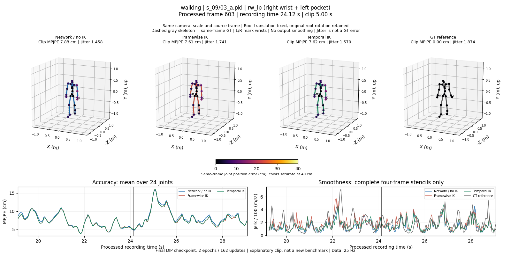
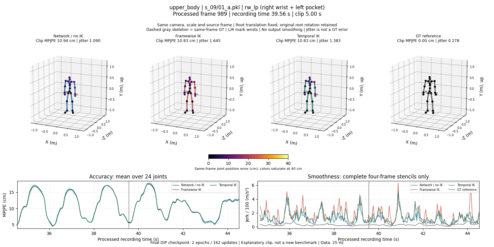
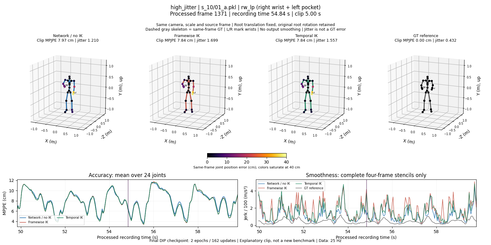

# V01: final DIP model four-way synchronized offline replay

English presentation updated 2026-11-19; original experiment dates and bytes are preserved in [the language/provenance guide](RECORD_LANGUAGE.md).

Date: 2026-11-19, America/Chicago. Explanation of existing F03/I01/I02 results using cached predictions; zero network forward calls/optimizer updates. Three original-speed animations, one slow replay and independent audit complete.

## Open animations

[Local overview](../outputs/local_dip/final_four_way_replay_v1_20261119/index.html) · [Walking](../outputs/local_dip/final_four_way_replay_v1_20261119/walking.gif) · [Upper body](../outputs/local_dip/final_four_way_replay_v1_20261119/upper_body.gif) · [High jitter](../outputs/local_dip/final_four_way_replay_v1_20261119/high_jitter.gif) · [High jitter0.25x](../outputs/local_dip/final_four_way_replay_v1_20261119/high_jitter_slow_025x.gif)

Left to right: network, no IK; framewise IMU-only IK; independent Temporal IK; DIP GT. Prediction panels overlay same-frame dashed-gray GT; points share one error color scale, saturated above40 cm while numeric errors remain complete. L/R mark wrists. Lower plots show per-frame MPJPE/jerk with moving black cursors. Purple dotted line marks archived J01's single-joint excess-jerk peak, not necessarily the mean-curve maximum.

Original GIFs: 250 frames×40 ms=10 s. Slow: the same 250×160 ms=40 s, no interpolation/filtering. Browser decoding can slow playback; GIF wall time is not inference latency. Large GIFs/GT/pose arrays remain in ignored output; compact metadata/reports are separately versioned.

Open from an ordinary WSL Terminal:

```bash
explorer.exe "$(wslpath -w /home/alex/research/PoseEstimationWithWearables/outputs/local_dip/final_four_way_replay_v1_20261119/index.html)"
```

## Freeze selection before rendering

All three use `rw_lp`, right wrist+left pocket, sensor IDs1/2, one of24 paper masks. Fix this common mask and selection without choosing on appearance, Temporal improvement or new clip scores.

| Purpose | Recording | Processed half-open frames | First–last timestamp | Fixed rule |
|---|---|---|---|---|
| Walking category | s09/03_a.pkl, seq5 | [478,728) | 19.12–29.08 s | Central250 frames of first s09 category03 recording |
| Upper-body category | s09/01_a.pkl, seq0 | [864,1114) | 34.56–44.52 s | Central250 of first s09 category01 recording |
| High-jitter example | s10/01_a.pkl, seq9 | [1246,1496) | 49.84–59.80 s | Prior J01 largest-contribution pair, centered on1371 peak |

Third clip is also upper-body, not a third category. It is an exploratory known test failure, not unbiased sampling. Prefixes label recordings, not every frame or specific exercise. Time starts at processed25 Hz recording, not absolute raw-device clock.

Final two-epoch checkpoint SHA-256:`996a3e2df21ac675df8f777d975d0700f3836c1d835bb898044a714e6cb5f7d8`. Both refinements use frozen caches; no solver reruns, tuning or changes to full-test results.

## Clip observations

These describe selected10 s clips only: 250 spatial frames, 247 complete in-clip jerk stencils. They do not replace all 19-recording×24-mask aggregate scores.

| Clip | Branch | MPJRE ° | MPJPE cm | Mesh MPJVE cm | Jitter, 100m/s³ |
|---|---|---: |---: |---: |---: |
| Walking | Network | 19.48235 | 7.82913 | 9.50656 | 1.45791 |
| Walking | Framewise IK | 19.05054 | 7.60993 | 9.27107 | 1.74066 |
| Walking | Temporal IK | 19.05740 | 7.61921 | 9.27993 | 1.57023 |
| Upper body | Network | 22.51347 | 10.94494 | 14.74359 | 1.09042 |
| Upper body | Framewise IK | 22.29233 | 10.83118 | 14.60150 | 1.64525 |
| Upper body | Temporal IK | 22.29560 | 10.83377 | 14.60073 | 1.38254 |
| High jitter | Network | 22.48105 | 7.97335 | 10.90179 | 1.20962 |
| High jitter | Framewise IK | 22.10122 | 7.83514 | 10.73252 | 1.69896 |
| High jitter | Temporal IK | 22.10547 | 7.83759 | 10.73445 | 1.55713 |

All three show slight spatial improvement/higher jitter with framewise IK. Temporal lowers framewise jitter9.79%/15.97%/8.35%, still7.70%/26.79%/28.73% above network. Clip percentages are not I02's full-test4.42% improvement.

Unobserved left wrist/hand dominate position errors. Upper-body network whole-body MPJPE10.94 cm, left wrist45.29 cm, left hand50.60 cm; framewise hand still50.56 cm. Small available-orientation improvements cannot recover every unobserved limb; whole-body means hide large local errors.

GT self-position/angular errors zero, but GT jitter nonzero: walking/upper/high1.87427/0.27826/0.43238. Walking GT jitter exceeds network; lower jerk alone does not establish accuracy.

[Four-metric CSV](results/final_four_way_replay_v1_20261119/clip_metrics.csv) · [Walking details](results/final_four_way_replay_v1_20261119/walking_summary.json) · [Upper details](results/final_four_way_replay_v1_20261119/upper_body_summary.json) · [Jitter details](results/final_four_way_replay_v1_20261119/high_jitter_summary.json)

Fixed central-frame previews, same source frame across four panels:







## Timing, direction and validation

Display `(X,Y,Z)→(X,-Z,Y)` is determinant+1, preserving handedness, length, Y-up. One camera/range/shared mean male, zero translation; retain each branch's root rotation. No reflection, heading fit, time shift, output smoothing or per-branch scaling.

Maximum root-direction error across selected clips/branches≈22.69°: no overall180° root reversal. This checks root, not correctness of every local joint. Larger walking adjacent root angles also occur in GT, so large steps alone do not diagnose renderer faults.

Four new known-trajectory/handedness/selection/clock tests pass; full 109 tests, no failures/skips. Independent750-frame/72,000-panel-joint-frame audit: poses bitwise match caches, GT matches processed recordings. FKchunk 11 versus saved joints: max difference0m; independent MPJPE/jitter summary discrepancy1.78e-15. All 1,000 encoded GIF frames decode: 40 ms originals, 160 ms slow; five fixed times match quantized PNG pixels exactly; slow/original corresponding frames match. Protected data, weights, training protocol/baseline hashes unchanged at this completed experiment.

Codex visually inspected five fixed times0/62/125/187/249 per clip, covering startup, middle, end, not every animated frame. Small temporal differences are interpreted with numerical curves; static screenshots alone do not prove smoother motion.

[Independent audit](results/final_four_way_replay_v1_20261119/independent_validation.json) · [Visual review](results/final_four_way_replay_v1_20261119/VISUAL_REVIEW.json) · [Final status](results/final_four_way_replay_v1_20261119/REVIEW_COMPLETION.json) · [109 tests](results/final_four_way_replay_v1_20261119/all_tests.log) · [Compact manifest](results/final_four_way_replay_v1_20261119/MANIFEST.json)

## Recalculation/provenance

```bash
conda activate imuposer
export PYTHONPATH="$PWD/src"
python tools/render_final_comparison.py prepare \
  --temporal-run outputs/local_dip/temporal_ik_v1_20261116/test \
  --diagnostic-run outputs/local_dip/ik_jitter_diagnostics_v1_20261116 \
  --output outputs/local_dip/final_four_way_replay_v1_20261119
python tools/render_final_comparison.py render \
  --output outputs/local_dip/final_four_way_replay_v1_20261119
python tools/validate_final_comparison.py \
  --output outputs/local_dip/final_four_way_replay_v1_20261119
```

These are actual parameters; reruns need a new directory, existing output is rejected. [Preparation/rendering](../tools/render_final_comparison.py), [independent audit](../tools/validate_final_comparison.py), [numerical tests](../tests/test_final_comparison.py). Run stores protocol, source snapshots, input/model/cache hashes, frame maps, metrics, GIFs, fixed PNGs, manifests. F03/I01/I02/frozen training protocol unchanged by V01 execution.

CPU rendering peak RSS≈839 MiB. Preserve `completion.json`'s immediate post-render/pre-validation state;`REVIEW_COMPLETION.json` is final reviewed status. Original artifact/validation manifests retained, additional review manifest covers later records. Compact RUN_* manifests describe the full local run; compact MANIFEST covers20 actually shared metadata/preview files, not large GIF/pose availability in Git.

This establishes explanatory offline replay. Real-iPhone coordinates, mounting calibration, synchronization/input adaptation remain next engineering work. Strict paper-setting unknowns stay in [alignment audit](PAPER_EVALUATION_ALIGNMENT.md).
