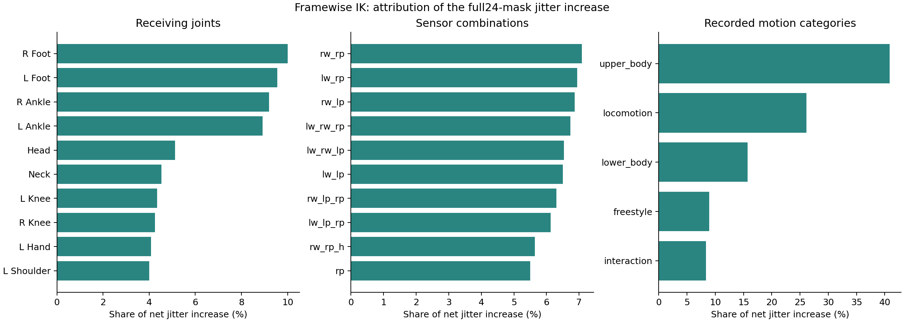

# J01：逐帧 IK 的 jitter 来源与高频诊断

日期：2026-11-16，America/Chicago。范围为原 I01 全部19条录制×24个传感器组合×24关节。保留原网络和逐帧IK缓存，不改权重、输入、指标或baseline。总体jitter增量为0.17309549（100 m/s³），即16.51%。逐关节/录制/组合的有符号贡献精确加总回这个增量。

**主要发现：额外抖动主要出现在远端关节，通过 pelvis/髋部修正沿运动链传播。** 17个含口袋输入的组合贡献95.95%的净增量；双脚和双踝四个接收关节贡献37.68%。受控地恢复原pelvis局部旋转后，总体jitter从1.22145降至1.09072，消除约75.53%的额外增量。该反事实只隔离姿态分量，不是重新优化后的可用IK方案；各分量效果不可相加。

## 哪些关节和组合

| 接收关节 | 本关节平均 jitter 增量 | 总体增量占比 |
|---|---:|---:|
| R Foot (11) | 0.41588 | 10.01% |
| L Foot (10) | 0.39703 | 9.56% |
| R Ankle (8) | 0.38202 | 9.20% |
| L Ankle (7) | 0.37061 | 8.92% |
| Head (15) | 0.21314 | 5.13% |
| Neck (12) | 0.18809 | 4.53% |
| L Knee (4) | 0.18054 | 4.35% |
| R Knee (5) | 0.17697 | 4.26% |

脚/踝的局部旋转没有被IK修改；变化来自其祖先节点。pelvis位置固定在原点，所以pelvis本身的“位置jitter”可以为零，但pelvis旋转仍使脚和头的世界位置变化。不能仅按哪个关节的局部参数改变来判断位置抖动来源。

| 组合 | 平均 jitter 增量 |
|---|---:|
| rw_rp | 0.29447 |
| lw_rp | 0.28841 |
| rw_lp | 0.28530 |
| lw_rw_rp | 0.27986 |
| lw_rw_lp | 0.27158 |
| lw_lp | 0.27030 |

所有表格jitter单位均为100 m/s³。全量明细：[逐关节](results/ik_jitter_diagnostics_v1_20261116/by_joint.csv)、[逐组合](results/ik_jitter_diagnostics_v1_20261116/by_mask.csv)、[逐录制](results/ik_jitter_diagnostics_v1_20261116/by_sequence.csv)、[逐mask×录制](results/ik_jitter_diagnostics_v1_20261116/by_pair.csv)、[关节×动作类](results/ik_jitter_diagnostics_v1_20261116/by_joint_category.csv)。大体量的10,944个mask×录制×关节单元及逐帧轨迹在原运行目录保留。

## 哪些动作类别和录制

本地数据包 `overview_of_published_data.txt` 明确说明文件名前缀依 [DIP论文 Appendix F / Table6](https://arxiv.org/pdf/1810.04703) 的类别编号：01上肢、02下肢、03行走、04自由运动、05交互。字母后缀只是同类别的子录制。这里有可靠的录制类别，不伪造逐帧动作标签，也不把自由运动的某个峰值直接认定为开合跳或拳击。

| 类别 | 每帧平均 jitter 增量 | 总体增量占比 |
|---|---:|---:|
| upper_body | 0.19756 | 40.88% |
| locomotion | 0.20649 | 26.15% |
| lower_body | 0.17651 | 15.72% |
| freestyle | 0.16066 | 8.92% |
| interaction | 0.08362 | 8.32% |

按对总体净增量的贡献排序，上肢最多；按每帧平均增幅，行走略高于上肢。这两个排名不同，因为录制时长和样本权重不同。

| 录制 | 动作类别 | 每帧平均增加 | 对总体增量的贡献 |
|---|---|---:|---:|
| s_10/01_a.pkl | upper_body | 0.18922 | 10.60% |
| s_09/01_a.pkl | upper_body | 0.18112 | 8.60% |
| s_10/01_b.pkl | upper_body | 0.22689 | 7.53% |
| s_10/03_b.pkl | locomotion | 0.19609 | 7.33% |
| s_09/03_a.pkl | locomotion | 0.23602 | 6.83% |

## 相邻帧旋转与频谱

直接计算原始/IK局部与全局旋转的相邻帧相对旋转，及修正 Q[t]=Rraw[t]^T Rik[t] 的旋转向量。频谱分析使用相邻帧相对旋转向量×25形成角速度，逐录制去线性趋势和Hann加窗；报告5–12.5Hz的绝对积分功率。没有对绝对轴角做FFT，避免π分支跳变制造伪高频。高频描述波动，不自动等同于噪声。

| 优化源关节 | 原相邻帧平均转角 ° | IK后 ° | 5–12.5 Hz 角速度功率变化 |
|---|---:|---:|---:|
| Pelvis (0) | 1.10943 | 1.13892 | +19.56% |
| L Hip (1) | 1.28427 | 1.28695 | +7.51% |
| R Hip (2) | 1.23356 | 1.24018 | +11.68% |
| L Shoulder (16) | 1.58417 | 1.60362 | +7.51% |
| R Shoulder (17) | 1.74192 | 1.75439 | +3.99% |
| L Elbow (18) | 2.13922 | 2.15046 | +3.68% |
| R Elbow (19) | 2.25677 | 2.26719 | +2.27% |
| Neck (12) | 0.91236 | 0.91476 | +5.87% |
| Head (15) | 0.69908 | 0.70654 | +11.96% |

pelvis的平均相邻帧转角只上升约2.66%，但高频角速度功率增加约19.56%；平均幅度不足以揭示高频影响。修正分量发生大于0.015 rad跳变的pelvis相邻帧对有34,296个。示例图中修正多次在约±0.01rad（±0.57°）附近切换，符合零起点、短预算Adam近似固定步幅后逐帧梯度方向改变的现象；图像与统计支持这种机制，但并未单独证明所有变化都由某一个优化器特性引起。

下图案例按“对总体增量贡献最大”预先指定的排序规则选取：s10/01_a.pkl、rw_lp，峰值jerk的四帧支撑结束于1371帧（54.84s）。不把这个案例的峰值当作全部录制的平均行为。

## 姿态分量反事实

| 修改 | Jitter，100 m/s³ |
|---|---:|
| 原网络 | 1.04836 |
| 完整逐帧IK | 1.22145 |
| IK中仅恢复原pelvis旋转 | 1.09072 |
| IK中恢复原左右髋旋转 | 1.20568 |
| IK中恢复原肩肘旋转 | 1.20584 |
| IK中恢复原颈/头旋转 | 1.22144 |
| 原网络只保留IK的pelvis修正 | 1.19007 |

pelvis是主要传播源，髋和肩肘也有影响；头部是明显的接收端，但直接颈/头修正对位置jitter的反事实影响很小。范数与运动链存在交互，75.53%不是可与其他百分比相加的独立因果份额。[全部反事实结果](results/ik_jitter_diagnostics_v1_20261116/counterfactual_results.json)。

## 验证与后续实验

已知多项式三阶差分、1Hz/7Hz频谱与有符号贡献解析测试通过。每个mask×录制的关节-only FK jitter都与原规范指标匹配；独立核对10,944个关节单元和所有分组贡献，误差与验证记录见[独立验证](results/ik_jitter_diagnostics_v1_20261116/independent_validation.json)。导数只在同一完整录制内部计算。

该诊断是原测试集上的描述性误差分析，不重新挑选原IK设置。新Temporal IK独立记录于 [I02实验](TEMPORAL_IK_EXPERIMENT.md)，保持I01目录、权重、协议和结果不变。完整诊断目录：`outputs/local_dip/ik_jitter_diagnostics_v1_20261116/`；反事实目录：`outputs/local_dip/ik_jitter_counterfactuals_v1_20261116/`。
