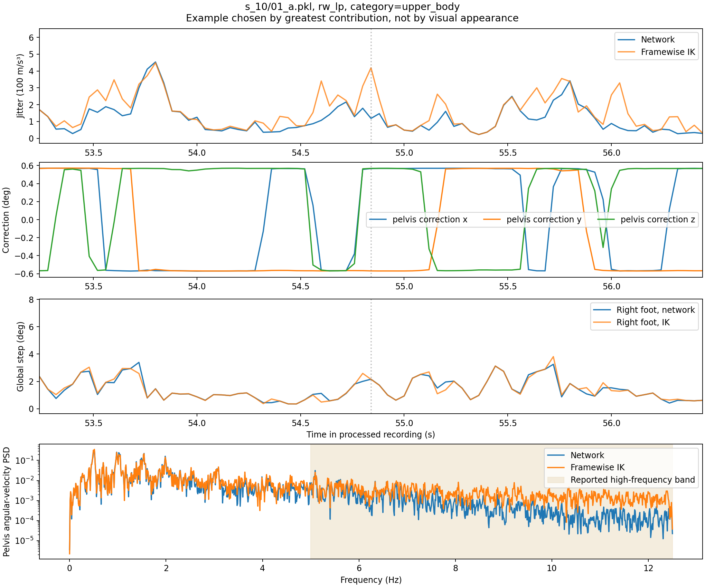

# J01: framewise-IK jitter sources and high-frequency diagnosis

English presentation updated 2026-11-19; original experiment dates and bytes are preserved in [the language/provenance guide](RECORD_LANGUAGE.md).

Date: 2026-11-16, America/Chicago. All 19 recordings×24 masks×24 joints from I01. Preserve raw/IK caches, weights, inputs, metrics/baseline. Overall jitter increase0.17309549(100m/s³), 16.51%. Signed joint/recording/mask contributions sum exactly to that increase.

**Extra jitter is concentrated at distal joints, propagating from pelvis/hip corrections along the kinematic chain.** Seventeen pocket-containing masks contribute95.95% of net increase; feet/ankles37.68%. Restoring only original pelvis local rotation reduces jitter1.22145→1.09072, removing75.53% of excess in that intervention. This isolates a pose component, not a newly optimized usable IK scheme; component effects are not additive.

## Receiving joints and masks

| Receiving joint | Mean joint jitter increase | Share of total increase |
|---|---: |---: |
| R Foot(11) | 0.41588 | 10.01% |
| L Foot(10) | 0.39703 | 9.56% |
| R Ankle(8) | 0.38202 | 9.20% |
| L Ankle(7) | 0.37061 | 8.92% |
| Head(15) | 0.21314 | 5.13% |
| Neck(12) | 0.18809 | 4.53% |
| L Knee(4) | 0.18054 | 4.35% |
| R Knee(5) | 0.17697 | 4.26% |

Foot/ankle local rotations are unchanged; ancestors drive their world-position changes. Pelvis stays at the origin, so its own position jitter can be zero while its rotation moves feet/head. Changed local parameters alone do not identify receiving-position jitter sources.

| Mask | Mean jitter increase |
|---|---: |
| rw_rp | 0.29447 |
| lw_rp | 0.28841 |
| rw_lp | 0.28530 |
| lw_rw_rp | 0.27986 |
| lw_rw_lp | 0.27158 |
| lw_lp | 0.27030 |

All jitter tables use100m/s³. Full [joints](results/ik_jitter_diagnostics_v1_20261116/by_joint.csv), [masks](results/ik_jitter_diagnostics_v1_20261116/by_mask.csv), [recordings](results/ik_jitter_diagnostics_v1_20261116/by_sequence.csv), [mask×recording](results/ik_jitter_diagnostics_v1_20261116/by_pair.csv), [joint×category](results/ik_jitter_diagnostics_v1_20261116/by_joint_category.csv). Full 10,944 mask-recording-joint cells/time series remain local.

## Motion categories and recordings

Dataset `overview_of_published_data.txt` explicitly maps filename prefixes to [DIP AppendixF/Table6](https://arxiv.org/pdf/1810.04703): 01 upper body, 02 lower body, 03 locomotion, 04 freestyle, 05 interaction. Letter suffixes denote same-class subrecordings. These are recording labels, not invented framewise actions; freestyle peaks are not automatically jumping jacks/punches.

| Category | Mean per-frame increase | Share of total increase |
|---|---: |---: |
| upper_body | 0.19756 | 40.88% |
| locomotion | 0.20649 | 26.15% |
| lower_body | 0.17651 | 15.72% |
| freestyle | 0.16066 | 8.92% |
| interaction | 0.08362 | 8.32% |

Upper body contributes most total excess; locomotion has slightly greater per-time increase. Different recording durations/weights explain different rankings.

| Recording | Category | Mean per-frame increase | Share of total increase |
|---|---|---: |---: |
| s_10/01_a.pkl | upper_body | 0.18922 | 10.60% |
| s_09/01_a.pkl | upper_body | 0.18112 | 8.60% |
| s_10/01_b.pkl | upper_body | 0.22689 | 7.53% |
| s_10/03_b.pkl | locomotion | 0.19609 | 7.33% |
| s_09/03_a.pkl | locomotion | 0.23602 | 6.83% |

## Adjacent rotations and spectra

Compute raw/IK local/global adjacent relative rotations and correction vectors Q[t]=Rraw[t]^T Rik[t]. Spectra use adjacent relative rotvecs×25 as angular velocity, per-recording linear detrending/Hann windows, absolute integrated5–12.5 Hz power. Do not FFT absolute axis angles, avoiding artificial high frequencies from pi-branch jumps. High-frequency variation is not automatically noise.

| Optimized source joint | Raw mean adjacent angle ° | IK ° | 5–12.5 Hz angular-velocity power change |
|---|---: |---: |---: |
| Pelvis(0) | 1.10943 | 1.13892 | +19.56% |
| L Hip(1) | 1.28427 | 1.28695 | +7.51% |
| R Hip(2) | 1.23356 | 1.24018 | +11.68% |
| L Shoulder(16) | 1.58417 | 1.60362 | +7.51% |
| R Shoulder(17) | 1.74192 | 1.75439 | +3.99% |
| L Elbow(18) | 2.13922 | 2.15046 | +3.68% |
| R Elbow(19) | 2.25677 | 2.26719 | +2.27% |
| Neck(12) | 0.91236 | 0.91476 | +5.87% |
| Head(15) | 0.69908 | 0.70654 | +11.96% |

Pelvis mean adjacent angle rises only 2.66%, while high-frequency power rises19.56%; mean amplitude misses temporal effects. Pelvis correction components jump>0.015 rad at34,296 adjacent pairs. Example corrections repeatedly switch around±0.01 rad(±0.57°), consistent with zero-initialized short-budget Adam's approximately fixed update size and changing per-frame gradient directions. Figures/statistics support this mechanism, not sole causality of every fluctuation.

Example selected by predeclared largest-total-contribution ranking: s10/01_a.pkl, rw_lp; peak four-frame jerk support ends at1371(54.84 s). Its peak is not overall average behavior.

## Pose-component counterfactuals

| Intervention | Jitter, 100m/s³ |
|---|---: |
| Raw network | 1.04836 |
| Full framewise IK | 1.22145 |
| IK, restore original pelvis only | 1.09072 |
| IK, restore original hips | 1.20568 |
| IK, restore original shoulders/elbows | 1.20584 |
| IK, restore original neck/head | 1.22144 |
| Raw network, apply IK pelvis correction only | 1.19007 |

Pelvis is the main propagation source; hips/arms also matter. Head is a receiver, but direct neck/head correction has small counterfactual position-jitter effect. Norm/chain interactions mean75.53% is not an independently additive causal share.[All counterfactuals](results/ik_jitter_diagnostics_v1_20261116/counterfactual_results.json).

## Validation/follow-up

Analytic polynomial third-difference, 1 Hz/7 Hz spectrum and signed-contribution tests pass. Joint-only FK jitter matches original canonical metrics for every mask/recording; independently audit10,944 cells/all grouped contributions: [validation](results/ik_jitter_diagnostics_v1_20261116/independent_validation.json). Differentiate within complete recordings only.

Descriptive diagnosis on the existing test set, not IK retuning. [I02](TEMPORAL_IK_EXPERIMENT.md) is separate and retains I01 weights/protocol/results. Full diagnosis:`outputs/local_dip/ik_jitter_diagnostics_v1_20261116/`; counterfactuals:`outputs/local_dip/ik_jitter_counterfactuals_v1_20261116/`.
