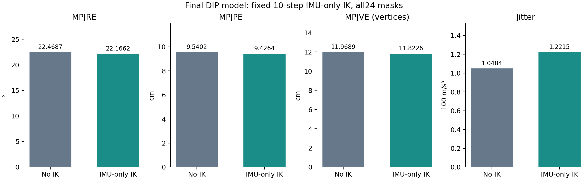

# IMU-only IK refinement: implementation, full evaluation and validation

English presentation updated 2026-11-19; original experiment dates and bytes are preserved in [the language/provenance guide](RECORD_LANGUAGE.md).

Completed: 2026-11-16, America/Chicago. IMU-only IK for the final two-epoch DIP model completed comparison/independent validation over all 19 s09/s10 recordings and24 configurations. **Three accuracy errors decrease slightly; jitter increases**, consistently in every mask aggregate. This is paper-guided reconstruction with explicit unrecovered details, not a line-by-line recovered author implementation.

**Independent follow-up, 2026-11-16: **[J01 jitter diagnosis](IK_JITTER_DIAGNOSIS.md) identifies pelvis-correction propagation. [I02 Temporal IK](TEMPORAL_IK_EXPERIMENT.md) retains98.58% of vertex-error gain and reduces jitter4.42% relative to this baseline, still above no IK. I01 values, sources/run remain the original baseline record.

## Same-model main results

| Metric | No IK | IMU-only IK | Relative change | Same-direction masks |
|---|---: |---: |---: |---: |
| MPJRE ° | 22.46870 | 22.16620 | 1.35% decrease | 24/24 |
| MPJPE(joints), cm | 9.54019 | 9.42636 | 1.19% decrease | 24/24 |
| MPJVE(mesh vertices), cm | 11.96889 | 11.82258 | 1.22% decrease | 24/24 |
| Jitter, 100m/s³ | 1.04836 | 1.22145 | 16.51% increase | 24/24 |

Retain F03 reduction: within masks, frame-weight spatial errors, T−3-weight jitter; then equal24-mask mean. Each mask24,078 frames, 24,021 jerk samples. MPJVE is vertex position error; jitter is predicted joint-position third difference, neither velocity error nor prediction-minus-GT jerk.

MPJVE improves11.96889→11.82258 cm, about 1.46 mm(1.22%); jitter rises16.51%. This is not improvement in all four metrics. Separate s09/s10 reductions likewise lower three errors and raise jitter; two subjects/correlated masks do not support significance or consumer-device generalization.

[Changes CSV](results/dip_imu_only_ik_v1_20261116/changes.csv) · [Per mask](results/dip_imu_only_ik_v1_20261116/per_mask.csv) · [Per subject](results/dip_imu_only_ik_v1_20261116/per_subject.csv) · [Full JSON](results/dip_imu_only_ik_v1_20261116/metrics.json)

## Evidence and explicit reconstruction choices

[IMUPoser §4.4](https://arxiv.org/html/2304.12518v1#S4.SS4) specifies absolute IMU orientation, MSE, Adam, 10 updates/frame, and shoulder/elbow optimization for wrists. Inspected [public commit a0e9d33](https://github.com/FIGLAB/IMUPoser/tree/a0e9d33b9c57d6737d711185b62084e17684b0e2) lacks that pose optimizer/full evaluation loop; inverse_kinematics_R converts global/local rotations.

IK learning rate, complete head/hip indices, rotation parameterization, target projection and state resets are not fully published. Freeze these before new test results; save [protocol](results/dip_imu_only_ik_v1_20261116/PROTOCOL.json)/source snapshot:

| Setting | Local implementation | Evidence boundary |
|---|---|---|
| Budget/objective | 10 Adam steps/frame; available global3×3 IMU orientation MSE; joint constraints together | Consistent with method text |
| Learning rate | 1e-3; betas0.9/0.999, eps1e-8, no decay | Cited AvatarPoser paper, not confirmed IMUPoser author value |
| Variables | Zero-initialized local right-multiplicative rotation-vector increments around network pose | Reconstruction; exponential map preserves SO(3) |
| Precision | FP64 optimization, FP32 output; original FP32 metric FK | Explicit execution choice |
| Output/state | Post-update10 pose; fresh Adam per frame, no state carry | No early stop, best-iterate selection or fallback |
| Degrees of freedom | Only listed joints; other local6D entries bitwise unchanged | Shoulder/elbow text supported; head/hip list reconstructed |
| Targets | Nearest-SO(3) projection of interpolated matrices, IK only | Processed/network input unchanged; reject singular/reflected/missing active data |
| Other inputs | No GT orientation/position/calibration, hidden IMUs, acceleration target or extra temporal smoothing | Only prediction[t], available orientation[t] |

[AvatarPoser §3](https://static.siplab.org/papers/eccv2022-avatarposer.pdf) gives IK lr 1e-3; its [public function](https://github.com/eth-siplab/AvatarPoser/blob/0f97cb27fa7ad97ceb9c02e4d068d613eb315ba0/models/network.py) defaults1e-1, five iterations, hand-position optimization. Use paper learning rate as predeclared reconstruction, not that position target or AvatarPoser's velocity meaning of MPJVE.

## Sensor/skeleton mapping

| Location | Constrained SMPL segment | Optimized local rotations |
|---|---|---|
| Left wrist | 18, left forearm/elbow | 16/18, shoulder/elbow |
| Right wrist | 19, right forearm/elbow | 17/19, shoulder/elbow |
| Left pocket | 1, left hip/thigh | 0/1, pelvis/left hip |
| Right pocket | 2, right hip/thigh | 0/2, pelvis/right hip |
| Head | 15, head | 12/15, neck/head |

Use public synthesis `ji_mask=[18,19,1,2,15,0]`, not stale `leaf_joints=[20,21,7,8,12]`. Wrist devices track forearm segments; old leaf indices would mislabel pockets as ankles. Preserve raw DIP indices `[7,8,9,10,0]`. [Issue16](https://github.com/FIGLAB/IMUPoser/issues/16) contains another user's question, not author confirmation.

Predeclare every 25th-frame sampling over all 41 first-eight recordings: 4,241 samples. Mean IMU/assigned-GT-global-angle differences: left wrist1.50°, right1.40°, left hip3.36°, right2.52°, head0.37°. Diagnostic only, no GT-fitted or changed calibration. Some training interpolations are not strictly orthogonal, supporting explicit network-input/IK-target separation. [Full training-side audit](results/dip_imu_only_ik_v1_20261116/train_conventions.json).

## Full execution and audit

Final `epoch_002_9d8a49a977cb.ckpt`, SHA-256 `996a3e2df21ac675df8f777d975d0700f3836c1d835bb898044a714e6cb5f7d8`. Training protocol, both original checkpoints, processed data, F03 unchanged. Model trained on GPU; this task optimizes pose variables/measures cached final outputs on CPU, no retraining/network inference.

Two228-pair CPU shards, 2 threads each, frame_batch256, about 4min43 s parallel. Added577,872 refined frames. `inputs/` NPZ contains network predictions, available orientations, mask/recording IDs/hashes, no GT. `refined/` stores poses, 11-point/frame loss histories, orientation residuals; metric stage separately reads GT from original cache.

Mean available-IMU angular residual12.60312°→10.95081°; orientation MSE never increases for any577,872 mask-frames. Optimization follows its objective, but this does not guarantee temporal smoothness. Third differences amplify framewise corrections; a plausible contributor to jitter, without individually isolating noise, projection and optimizer discretization causes here.

- Ten IK numerical/isolation and four analytic aggregation tests pass.
- Independent audit of1,424 original artifacts, all 456 input/output pairs, all protected source/weight/data hashes.
- Available IMUs match processed data bitwise; missing channels zero; 11,437,050 unoptimized joint-frame6D entries bitwise unchanged.
- Independent overall aggregation max difference1.78e-15.
- First/last masks×first/last recordings, frames0/1/124/125/last: batch 1 ten-step rerun exactly matches batch 256.
- Same four full-recording pairs, both models, FKchunk 11 versus32: max four-metric difference1.194e-12, below predeclared1e-4.

[Independent JSON](results/dip_imu_only_ik_v1_20261116/independent_validation.json) · [Compact manifest](results/dip_imu_only_ik_v1_20261116/MANIFEST.json) · [Pre-execution evidence/decisions](results/dip_imu_only_ik_v1_20261116/SOURCE_FINDINGS.md)

Implementation: [imu_only_ik.py](../tools/imu_only_ik.py); coordination/resume: [eval_imu_only_ik.py](../tools/eval_imu_only_ik.py); audit: [validate_imu_only_ik.py](../tools/validate_imu_only_ik.py). Full run:`outputs/local_dip/dip_imu_only_ik_v1_20261116/`, with original/additional manifests. Batched throughput is not real-device end-to-end latency.

## Paper alignment and next work

[Remaining alignment](PAPER_EVALUATION_ALIGNMENT.md) records21 evidence items, 12 display groups and reduction/shape/mesh sensitivity. Fine-tuning→rolling→IMU-only IK→all 24 four-metric DIP chain works. Strict numerical reproduction remains limited by missing author details/historical AMASS differences. Test results did not select new learning rate, joints, budget or smoothing. Preserve raw/IK predictions for comparison when author settings become available.
