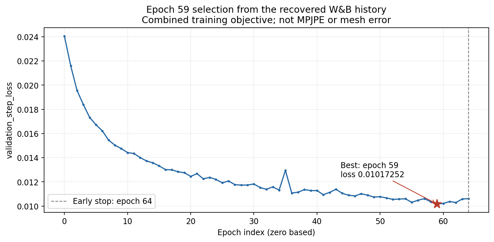

# IMUPoser reproduction objectives and Epoch 59 audit

English presentation updated 2026-11-19; original experiment dates and bytes are preserved in [the language/provenance guide](RECORD_LANGUAGE.md).

Audit date: 2026-11-11. Subject: local `IMUPoserGlobalModel_global-10062026-021332` run/Epoch 59. Requested by Alex, reviewed with Codex.

**Decision: retain Epoch 59; do not restart AMASS now. Complete DIP evaluation/fine-tuning first.** Label it “public-code AMASS-pretrained baseline with known paper differences.” Strict training alignment requires a separate traceable run after resolving24 masks, budget, coverage. Removing global from evaluation cannot erase past training exposure.

This task completed objectives, paper comparison, data inventory, training/checkpoint audit; no training/inference. E02–E04 sensor studies remain supplementary, lower priority.

**2026-11-13: **four metrics/known-pose validation complete: [POSE_METRICS.md](POSE_METRICS.md). Rolling last output, per-frame tracing and full-development chunk comparison complete: [ROLLING_INFERENCE.md](ROLLING_INFERENCE.md). Stride1 is explicit local policy; paper overlap/raw causality remain open. Tables/CSV below preserve2026-11-11 status; fine-tuning/refinement/full configurations were then pending.

**2026-11-14: **DIP protocol frozen, all first-eight recordings raw-matched; Epoch 59 three-update smoke, gradient/parameter/save/reload/deterministic-continuation checks pass: [DIP_FINETUNING.md](DIP_FINETUNING.md). CPU engineering only; no formal30-epoch/final training or new test scores. New fine-tuning uses24 masks; historical25-mask initialization remains.

**2026-11-16: **30-epoch development selects K=2; final first-eight two-epoch GPU training/full 24 comparison complete: [DIP_FINETUNING_COMPARISON.md](DIP_FINETUNING_COMPARISON.md). Paper-guided IMU-only IK, 456 pairs/independent audit: three errors slightly lower, jitter+16.51%: [IMU_ONLY_IK.md](IMU_ONLY_IK.md). [21-item alignment/sensitivity](PAPER_EVALUATION_ALIGNMENT.md) retains unresolved author IK/window/shape/reduction. The historical table is not rewritten as current state or proof of strict numerical equivalence.

## Scope/completion criteria

| Phase | Scope | Deliverables |
|---|---|---|
| 1 | DIP quantitative evaluation | Fixed initialization/differences; traceable DIP split/selection; verified rolling, IMU refinement, four metrics, all 24 configurations; per-config and paper-corresponding aggregates |
| 2 | Consumer-device data/live system | Author IMUPoser Dataset evaluation; sync/calibration/location handling; live input/pose output, hardware latency, device-location detection |
| Deferred | New architectures, sensor searches, performance optimization | Revisit explicit failures after a complete baseline; preserve original reports/results |

Phase 1 success means explainable protocol/metrics/differences, not accidentally hitting a number. Epoch 59 results retain recipe-difference labels; unresolved differences mean reproduction with known deviations, not identical training recreation.

Evidence: [IMUPoser v1 §3–6](https://arxiv.org/html/2304.12518v1), recorded public-code commit[a0e9d33](https://github.com/FIGLAB/IMUPoser/tree/a0e9d33b9c57d6737d711185b62084e17684b0e2). Paper, current inspectable code and historical evidence are distinct; public code is not a complete frozen paper experiment.

## Paper/implementation comparison

Filterable [CSV](reproduction_audit_20261111/paper_implementation_comparison.csv).

| Item | Paper setting | Current evidence | Difference/action |
|---|---|---|---|
| Model | Two-layer BiLSTM; 60 input, 512 hidden, 144 output | 20 checkpoint network tensors; 10,680,976 parameters; original architecture matches | Keep architecture; lock actual import path |
| Training corpus | AMASS; about 63 hours in paper | Current loader selects18 AMASS .pt files, 37.7289 h retained frames | Raw and processed durations differ; do not subtract as missing hours; record versions, filters, omissions |
| Training masks | 24 location combinations | Current and recorded Git baseline enumerate25, including extra five-location global | Paper/public-code recipe difference; not global-only training; strict24-mask alignment needs a new run |
| Sampling/input | 25 FPS; global acceleration/orientation; acc scale30; missing-zero | Current convention matches; retain first 5 locations, discard sixth pelvis input | Fix channel order/units/masks; three locations still use60D, not36D |
| Synthesis/preprocessing | Virtual SMPL sites; five-frame mean | Both preprocessing scripts match recorded Git HEAD; intermediates reconstruct final acc/ori/pose | Acc mean, entrywise orientation interpolation, axis-angle pose interpolation then matrices; paper tensor details incomplete |
| Frame-rate filtering | Current per-file exclusions not specified | Accept int(fps)59/60/120; 120→60; drop short recordings | Check original fps for EKUT/KIT; do not assume failed download or silently rewrite preprocessing |
| Training windows | Nonoverlapping125 frames | 125 frames; retain short tails; batch zero padding | Training loss does not mask padding; distinguish reporting that excludes it |
| Optimizer | Adam, lr 3e-4, batch 256 | Saved lr, betas, eps, decay; Adam source supported; batch 256 unsaved class default supported by step counts | Retain Adam, not skill LLM optimizer advice; separate batch evidence level |
| Epoch budget | 80 epochs | Epochs0–64 completed; best59; early stop64 | 65 completed differs from 80; retain baseline now, freeze strict-run budget separately |
| Selection | Internal validation details incomplete | Mask expansion then random90/10; minimum validation_step_loss | Not subject/motion independent; different masks can cross split; historical indices unavailable |
| DIP fine-tuning | s_01–s_08 train; s_09/s_10 test | Audited Epoch 59 is GlobalModel AMASS-pretrained; no DIP training recorded in that run | Build traceable fine-tuning/split/selection; module existence does not prove execution |
| Inference | Online125 history; also says1-sample overlap | E02–E04 independent nonoverlapping chunks use full within-chunk context | Specify stride/output/startup/lookahead; do not equate overlap wording with an unverified stride |
| Rotation refinement | IMU-orientation optimization, 10 iterations/frame | At audit date, raw network outputs; GT-assisted replacement is diagnostic | Implement available-IMU refinement; no GT inference constraints |
| Rotation/position metrics | Global MPJRE, root-aligned MPJPE | Global/local angle and root-relative MPJPE available | Check joints/root/shape/weights; local error does not replace MPJRE |
| Main metric/smoothness | MPJVE is mesh-vertex error; also jitter | Neither mesh MPJVE nor jitter computed at audit date | Add mesh/jerk; units, fps, boundaries, means; MPJVE not velocity |
| Configuration aggregation | 24 combinations, 12 display classes | Only some masks in current study, plus five-location reference outside paper budget | Export all 24 per-recording results, freeze grouping/reduction; mark missing author details |
| Consumer/live system | Consumer dataset and hardware validation | DIP proxy locations/offline inference | Phase 2; GIF and CPU workflow time do not establish hardware accuracy/end-to-end latency |

## Why the audit-date numbers are not directly comparable

| Number | Meaning | Limitation |
|---|---|---|
| E02 five-location MPJPE7.8866 cm | Epoch 59, all retained DIP-test frames, five inputs, offline chunks | Outside paper1–3-location budget; no fine-tuning/online/refinement |
| E02 three-location9.4112 cm | Only lw_rp_h, raw network, same test split | One configuration not all combinations; other protocol differences persist |
| E04 two wrists+head9.4467 cm | s_07/s_08 development, subject-equal | Different people/split; closeness to paper test score is not comparable evidence |
| Validation loss0.0101725226 | 6D pose MSE+FK joint MSE | Neither cm MPJPE nor primary mesh MPJVE |

First resolve evaluation differences, then decide whether residual training differences require correction. Historical test error analysis is acknowledged; later fixed-protocol reporting is permissible but not an untouched blind test.

## Evidence levels/history boundaries

| Level | Confirmable facts | Evidence |
|---|---|---|
| Direct historical records | Checkpoint epoch/step, serialized instance, optimizer, callbacks, 65 validation rows, command/software | [Checkpoint](reproduction_audit_20261111/checkpoint_metadata.json), [run](reproduction_audit_20261111/run_metadata.json), [history](reproduction_audit_20261111/validation_history.csv) |
| Repeatable current checks | Current inventories/hashes, tensor shapes/finiteness, reconstruction, masks, source/HEAD differences | [Containers](reproduction_audit_20261111/processed_data_manifest.csv), [sequences](reproduction_audit_20261111/processed_sequence_manifest.csv), [reconstruction](reproduction_audit_20261111/preprocessing_reconstruction.csv), [source comparison](reproduction_audit_20261111/source_comparison.csv) |
| Corroboration, not historical proof | Current18-file sample count exactly explains past steps | [Summary](reproduction_audit_20261111/audit_summary.json); does not prove past file hashes equal today's |
| Not recovered | Historical file hashes/order, split indices, full RNG, mask exposure, AMASS version, all uncommitted sources | W&B stores Git commit/Config repr; class attributes not fully serialized |

Most accurate corpus claim: **current directory, preprocessing logs and checkpoint counts support the18 subsets below; no training-time hash inventory authenticates each historical file.**

## AMASS/preprocessing audit

Raw directory contains all 20 configured subsets; 25 FPS training has18. `preprocess_full_retry.log` explicitly marks EKUT/KIT “not supported.” [Raw fps summary](reproduction_audit_20261111/raw_amass_summary.json), [candidate inventory](reproduction_audit_20261111/raw_amass_inventory.csv). ZIP CRC describes entries, not cryptographic identity; not every original archive received SHA-256 here.

Inspect **14,244** raw candidates: **4,686** excluded by fps, **4** by length, **9,554** retained. Counts match processed subsets; this is count agreement, not per-motion raw content matching.

| Subset | Exclusions |
|---|---|
| EKUT | All 349 at100 Hz, unsupported |
| KIT | All 4,232 at100 Hz, unsupported |
| Eyes_Japan_Dataset | 57 at250 Hz excluded; 693 retained |
| MPI_mosh | 39 at100 Hz excluded; 38 retained |
| TCD_handMocap | Nine at150 Hz excluded; 53 retained |
| CMU/BioMotionLab_NTroje | Three/one recordings≤12 frames after60 Hz conversion |

Filters match Git HEAD preprocessing. Including100/150/250 Hz later requires a new data version/run, not silent replacement while claiming the old recipe.

| Current global-training subset | Sequences | 25 FPS frames | 125-frame windows including tails |
|---|---: |---: |---: |
| ACCAD | 252 | 40,262 | 443 |
| BioMotionLab_NTroje | 3,060 | 785,738 | 7,653 |
| BMLhandball | 649 | 153,314 | 1,564 |
| BMLmovi | 1,801 | 254,775 | 2,766 |
| CMU | 2,079 | 828,371 | 7,635 |
| DanceDB | 153 | 314,262 | 2,588 |
| DFaust_67 | 129 | 17,240 | 184 |
| Eyes_Japan_Dataset | 693 | 499,427 | 4,067 |
| HUMAN4D | 148 | 108,991 | 943 |
| HumanEva | 28 | 12,723 | 114 |
| MPI_HDM05 | 215 | 216,921 | 1,841 |
| MPI_Limits | 35 | 31,257 | 268 |
| MPI_mosh | 38 | 12,049 | 113 |
| SFU | 44 | 22,872 | 204 |
| SSM_synced | 30 | 2,819 | 39 |
| TCD_handMocap | 53 | 10,201 | 127 |
| TotalCapture | 37 | 61,665 | 511 |
| Transitions_mocap | 110 | 22,711 | 233 |
| **Total** | **9,554** | **3,395,598** | **31,293** |

3,395,598 frames≈**37.7289 h**, excluding mask duplication. `dip_train.pt`: 41 recordings, 105,493 frames;`dip_test.pt`: 19,24,078; neither selected by current global training loader. Datamodule setup constructs a test dataset; construction/read does not mean feeding training/validation loaders.

Across20 processed containers, **28,842 sequence-field checks** reconstruct stage2 acc/ori/pose bitwise. Today's25 FPS data match existing stage1 intermediates/current converter. This does not prove each stage1/raw historical mapping or data hashes on2026-10-06. Source scripts, current SHA-256 and per-sequence field hashes are saved.

## Training configuration/checkpoint selection

| Item | Finding | Evidence boundary |
|---|---|---|
| Run | wk8tfuyl, start2026-10-06 07:13:33UTC | Local W&B metadata |
| Arguments | --combo_id global --experiment IMUPoserGlobalModel --num_workers 0 | No --fast_dev_run/--resume_from |
| Weights | Epoch 59, step 165,060, SHA-256 `02b9211b57ca36ae3fb13dcacc4b008b49a31fd360ebea516b73d103bd2a5058` | Original checkpoint, not Epoch 55 handoff |
| Config instance | GlobalModelIMUPoser, 60D, 24-joint6D, joint loss, MSE, workers0 | Serialized instance fields |
| Optimizer | lr 0.0003, betas0.9/0.999, eps1e-8, decay0, no scheduler | Saved groups/steps; Adam type supported by current/Git source |
| Batch/window/split | 256/125 frames/90%–10% | Unsaved class attributes/source; counts corroborate |
| Seed | seed_everything(42, workers=True) in launcher | Current/Git code; Config.torch_seed=0 is not this call; full historical RNG unavailable |
| Loss | Pose MSE+FK-position MSE, current source includes padding | Not cm position error or independent-motion validation |
| Selection | Minimum validation_step_loss, keep best5 | Callback/best_model.txt agree |
| Best | Epoch 59,0.010172522626817226 | Minimum65-row history, equals callback score |
| Stop | Epoch 64, wait_count5, stopped_epoch64 | Final EarlyStopping; epochs0–64=65 |
| Software | Python 3.10.21, Torch2.7.0+cu128, Lightning1.9.5, NumPy1.23.5 | Historical requirements/metadata; modern compatibility differs from original README |

W&B config.yaml stores a Python object repr, not every hyperparameter. Recorded commit excludes uncommitted edits. Current-vs-HEAD file hashes are saved; current workspace is not claimed as a complete historical snapshot.



This loss selected the checkpoint, not paper accuracy. Plot uses65 recovered rows: [plot_validation_history.py](reproduction_audit_20261111/plot_validation_history.py).

## Sample/step cross-check

Current loader order, retained tails, 25 masks, class defaults:

- 31,293 windows×25=**782,325** samples.
- int(782325×0.9)=**704,092** training; **78,233** validation.
- Batch256, retain last: **2,751** training/**306** validation batches per epoch.
- 2,751×60=**165,060**, exact Epoch 59 count.
- 2,751×65=**178,815**, exact final count; logged3057/3057=2,751+306.

W&B trainer/global_step165,059/178,814 is one below post-update checkpoint counts, consistent throughout history, not evidence of missing updates.

This excludes obvious sample-scale mismatch, not uniquely identifies files/split indices: equal total windows can contain different content.

## Effect of25 masks

Dictionary: **5 single, 10 double, 9 triple, one five-location global**. Removing global gives24 paper-budget combinations. Recorded Git baseline already has it; not introduced by recent placement experiments.

`--combo_id global` establishes five-location60D network slots; dataset still enumerates every mask. It does not mean global-only training. Separate supported input slots from training enumeration; do not remove every global setting indiscriminately.

| Known effect | Quantity/meaning |
|---|---|
| Extra samples | One duplicate/motion window; 31,293 extra |
| Enumeration size | 25 versus24: +4.1667%; no new raw motions |
| Nominal pre-split exposure | Each mask1/25; global4%, other24 total 96% |
| Same-window dependence | Mask expansion before random split permits train/validation correlation |
| Hypothetical24 masks | 751,032 samples; about 2,641 training batches/epoch at same 90/10, batch 256, versus2,751 |
| Unknown | Actual historical per-mask sampling and sign/magnitude of global exposure's sparse-accuracy effect |

Known recipe difference, **no evidence it necessarily helps or hurts sparse accuracy**. A controlled24-vs-25 training experiment is needed for causality, not a prerequisite for this audit/next evaluation work.

## Retraining decision/next steps

1. **Retain Epoch 59 now: **usable initialization with optimizer/selection evidence and consistent scale; no NaN/step anomaly requiring discard. Preserve weights/results; loss alone is not reproduction.
2. **Complete evaluation/DIP first: **freeze metrics, rolling, refinement, repeatable fine-tuning/selection; separate measurement differences from expensive new pretraining.
3. **Strict training later requires a separate run: **confirm AMASS version, 100 Hz handling, 24 masks, 80 epochs, validation. Continuing25-mask weights cannot equal never-global training.
4. **Record development/final roles separately: **reserve s07/s08 now; freeze hyperparameters/selection before final s01–s08 training, new run, explicitly retire independent-validation status. Old loader does not automatically exclude reserved indices.

| Priority | Work | Completion |
|---|---|---|
| P0 | Resolve DIP evaluation choices | Output, stride, startup, filter, shape, root, reduction, jitter units explicit; document evidence/decisions for missing details |
| P0 | Independent four-metric numerics | Known poses; distinguish MPJVE/MPJPE, local/global |
| P1 | Fine-tuning entry/data filtering | Explicit train/dev indices, no test checkpoint selection, config/source snapshots |
| P1 | Rolling/IMU-only refinement | Same-checkpoint controlled switches, no GT inference |
| P1 | All 24 configurations | Per-recording/mask raw metrics/paper-corresponding aggregate, retain recipe-difference label |
| P2 | Decide strict AMASS run | Freeze coverage/masks/budget, locate baseline differences |

## Traceable artifacts/commands

Read-only collector: [audit_reproduction.py](../tools/audit_reproduction.py). Writes statistics, hashes, code to a new directory, not data/weights. Rechecks original/intermediate/25 FPS/checkpoint hashes at collection end.

```bash
cd /home/alex/research/PoseEstimationWithWearables
conda run --no-capture-output -n imuposer python tools/audit_reproduction.py \
  --original-root /home/alex/research/IMUPoser \
  --output-dir docs/reproduction_audit_20261111_recheck
```

Refuse existing output. [Evidence index](reproduction_audit_20261111/audit_summary.json), [collection verification](reproduction_audit_20261111/collection_validation.json). Source snapshots describe audit day, not retroactively training day. W&B binary history parsed read-only with per-fragment CRC, following [official DataStore](https://github.com/wandb/wandb/blob/v0.19.11/wandb/sdk/internal/datastore.py); no dependency changes.

[Progress/experiments](RESEARCH_LOG.md). This dated task is audit/planning; subsequent training/evaluation was pending.
