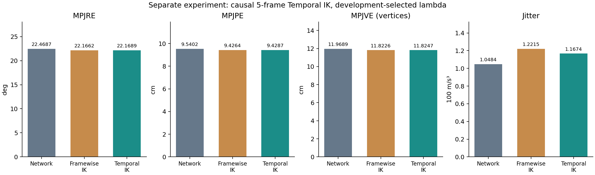

# I02：独立 Temporal IK 实验

完成日期：2026-11-16，America/Chicago。此为原 I01 逐帧 IK 之外的新实验，保留所有原模型、训练协议、I01算法、缓存和结果。**Temporal IK 相比逐帧 IK 降低 jitter 4.42%，保留98.58%的 MPJVE 改善收益；jitter仍比无IK高11.36%，属于部分缓解。**

## 固定测试结果

同一最终两轮 DIP checkpoint，s09/s10全部19条录制、24个组合、每mask24,078帧；mean male、root平移对齐、全24关节/6890顶点、原四指标与汇总方式不变。

| 指标 ↓ | 无IK | 逐帧IK（I01） | Temporal IK（I02） |
|---|---:|---:|---:|
| MPJRE ° | 22.46870 | 22.16620 | 22.16886 |
| MPJPE cm | 9.54019 | 9.42636 | 9.42868 |
| MPJVE cm | 11.96889 | 11.82258 | 11.82466 |
| Jitter，100 m/s³ | 1.04836 | 1.22145 | 1.16742 |

保留收益定义为 `(MPJVE无IK−MPJVE Temporal)/(MPJVE无IK−MPJVE逐帧IK)`，不是声称三个误差都完全不变。Temporal比I01的MPJVE增加0.00207cm，约0.021mm，但相对无IK仍改善0.14423cm。三种精度误差在全部24组合的录制汇总中都低于无IK；Temporal jitter在24/24组合上低于I01，在0/24组合上低于无IK。

预先规定的折中标准是三项误差不差于无IK、保留至少50%的I01顶点精度收益、jitter低于I01；本次达到。更强的“jitter恢复到无IK或更低”标准没有达到。没有根据这些测试分数重新选择权重。



[总体CSV](results/temporal_ik_v1_20261116/comparison.csv) · [24组合](results/temporal_ik_v1_20261116/per_mask.csv) · [19录制](results/temporal_ik_v1_20261116/by_sequence_id.csv) · [动作类别](results/temporal_ik_v1_20261116/by_category.csv) · [受试者](results/temporal_ik_v1_20261116/by_subject.csv) · [关节jitter](results/temporal_ik_v1_20261116/joint_jitter.csv)

## 方法：只用过去与当前的5帧

对输出t，取原网络预测和可用IMU方向的 `[max(0,t−4),t]` 五帧历史。联合优化窗口内与I01相同的局部旋转自由度，仍由网络姿态零增量开始，最终只输出第t帧；每窗口独立Adam，不跨录制或窗口携带优化状态。

```text
L = sum_valid_frames orientation_matrix_MSE
    + λ * sum_valid_four_frame_stencils mean((D3 joint_position / 0.01m)^2)
```

关节位置由固定mean-body骨架和候选局部旋转经FK生成，不使用观测GT位置。正则的D3是以帧为间隔的离散三阶差分，0.01m是预先指定的尺度；评估jitter仍按原25³乘子和100单位换算。此处直接约束运动连续性，没有在输出后另加低通滤波。

| 参数 | 冻结值 |
|---|---|
| 优化预算 | 10步Adam，lr1e-3，betas0.9/0.999，eps1e-8 |
| 窗口 | 5帧，含当前及过去4帧；步长1，仅取末帧 |
| λ | 0.001，只由开发侧选择 |
| 时序正则 | 全24关节位置的三阶差分平方，尺度0.01m |
| 姿态变量/IMU目标 | 同I01的局部SO(3)增量与可用方向投影；FP64优化、FP32输出 |
| 可修改关节 | 同I01按mask选择，其余local6D条目逐位保持 |
| 起始/边界 | 有效短前缀；仅完整有效四帧计算正则，绝不跨录制 |
| 额外未来信息 | 0；独立批量past窗口只是计算加速 |

过去5帧无需等待未来帧；原processed输入中的居中加速度/填补/插值依赖仍与I01相同。当前只证明Temporal IK自身不增加未来信息，未把整个上游管线宣称为严格原始流实时系统。

实现：[temporal_ik.py](../tools/temporal_ik.py)，实验入口：[experiment_temporal_ik.py](../tools/experiment_temporal_ik.py)。这是新增时序正则研究，不能把它回写为IMUPoser原论文已公开的方法。

## 训练侧选择，不在测试结果上挑参数

使用开发阶段的epoch2权重（SHA `4515e13ae95ee5ec49ff90d941c81149ec4c583ba293aadf21abe17de699ba16`），它训练于s01–s06。校准数据为s07/s08的全部11录制，各取中央96连续帧，并补4帧过去的姿态输出供窗口历史；12个左右镜像展示类各固定一个代表，共132配对、12,672个有效评价帧。

每个原网络输出仍有原125帧滚动历史。区间预测已与既有滚动实现做一致性检查；没有为了减少计算改成无上下文分块。λ=0在全部132个实际校准配对上与原I01逐帧IK输出完全相同，最大差0。

先冻结候选 `[0.001,0.01,0.1,1]`、预算和选择规则：三项误差均不差于无IK，至少保留50%逐帧IK的MPJVE收益，且jitter低于逐帧IK；在满足者中取jitter最低。若全不满足则按已记录的空间违约量与jitter排序，并如实标失败。本次只有λ0.001满足约束。

| λ | 校准 MPJVE cm | 校准 jitter | 满足选择约束 |
|---|---:|---:|---|
| 0.001 | 10.47713 | 1.34948 | True |
| 0.01 | 10.51317 | 1.43462 | False |
| 0.1 | 10.56604 | 1.44215 | False |
| 1.0 | 10.58930 | 1.42812 | False |

校准panel的无IK/逐帧IK jitter为1.26048/1.37946，MPJVE为10.58667/10.47090cm。较大的正则权重在固定10步预算下没有单调降低最终jitter，不能把“权重大”当作一定更平滑。校准只使用训练侧数据，随后冻结 [selection.json](results/temporal_ik_v1_20261116/calibration_selection.json) 和 [测试协议](results/temporal_ik_v1_20261116/PROTOCOL.json)，才运行全24-mask测试。

原测试集已被历史错误分析使用，不是全新的盲测；本次Temporal权重选择没有使用Temporal测试分数。校准panel较短、只有两名开发参与者，结论不等于最优参数或新增人群泛化。

## 受影响关节的变化

下表为各关节全24mask和全部录制的加权jitter，单位100m/s³。脚、踝与头是原诊断中的主要接收端，本次有所恢复，但仍高于无IK。

| 接收关节 | 无IK jitter | 逐帧IK | Temporal IK |
|---|---:|---:|---:|
| R Foot | 1.51390 | 1.92978 | 1.79981 |
| L Foot | 1.52938 | 1.92641 | 1.80407 |
| R Ankle | 1.32719 | 1.70921 | 1.59154 |
| L Ankle | 1.37972 | 1.75033 | 1.63614 |
| Head | 0.79382 | 1.00696 | 0.93905 |

原抖动来源的定位、频谱和受控pelvis反事实见 [J01诊断](IK_JITTER_DIAGNOSIS.md)。这里没有通过对测试集逐mask关闭IK、恢复某些关节或重新选择模型来改善汇总。

## 验证与追溯

- 6项Temporal数值/边界/缺失传感器/未来扰动测试、2项区间预测与固定选择规则测试通过；另有3项J01信号/贡献测试。
- 固定骨架FK与原mean-body FK的集成检查最大位置差2.02e-7m。
- 独立验证922个原测试结果文件、全部456对输入输出、原数据/模型/源码/选参结果哈希和11,437,050个未优化joint-frame。
- IK输入无GT，原无IK和I01指标行逐位保留；校准选参规则独立复算通过。
- 独立整体汇总最大差1.78e-15。
- 首尾mask×首尾录制，重跑0/1/3/4/124/125/末帧各自的独立past-only窗口，最大输出差0；首尾窗口和录制边界未引入未来帧。
- 固定完整录制使用FK chunk11重算四指标，对比原chunk32最大差1.237e-12，低于1e-4阈值。

[独立验证](results/temporal_ik_v1_20261116/independent_validation.json) · [校准协议](results/temporal_ik_v1_20261116/calibration_PROTOCOL.json) · [校准完整指标](results/temporal_ik_v1_20261116/calibration_metrics.json) · [运行环境](results/temporal_ik_v1_20261116/RUNTIME.json) · [元数据清单](results/temporal_ik_v1_20261116/MANIFEST.json)

完整输出为 `outputs/local_dip/temporal_ik_v1_20261116/calibration/` 与 `test/`。测试两个CPU分片各约7分钟；没有重新训练模型，只有校准阶段对开发权重做了新的网络预测，测试阶段直接复用原最终网络缓存。所有旧I01文件、训练协议、checkpoint与processed数据保持不变；原始和追加验证manifest分别保存。

本实验确认：在这套固定流程下，可以保留几乎全部IK空间收益并降低一部分额外jitter；尚未把jitter降回原网络水平。后续若改变优化预算、正则形式或权重，需要另立实验并继续用训练侧选参，不从当前测试分数反推最优设置。
