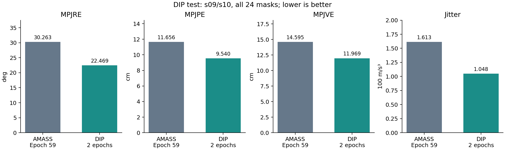

# DIP 微调前后四指标

测试集 s09/s10，共 19 条录制、24,078 帧，全部 24 个 mask。每个 mask 内空间误差按帧数加权，jitter 按 T−3 加权，再对 mask 等权平均。

| 指标 | 微调前 | 两轮微调后 | 相对改善 | 改善组合数 |
|---|---:|---:|---:|---:|
| MPJRE (deg) | 30.26337 | 22.46870 | +25.76% | 24/24 |
| MPJPE (cm) | 11.65586 | 9.54019 | +18.15% | 24/24 |
| MPJVE (cm) | 14.59548 | 11.96889 | +18.00% | 24/24 |
| Jitter (100 m/s³) | 1.61320 | 1.04836 | +35.01% | 24/24 |

相对改善为 (前−后)/前×100%；正值为下降。MPJVE 是网格顶点位置误差。Jitter 是预测关节位置的三阶差分，表格单位 100 m/s³。

推理设备：cpu。125 帧滚动窗口、步长 1、取最后有效帧、前缀起步；保持原滤波，无 IK。

独立核查通过：456 个配对缓存及所有 GT，1,155,744 个预测帧；独立重算汇总和固定 8 次 FK 分块重算通过。

本结果是固定模型的描述性测试比较；两名测试者不足以支撑统计显著性结论。尚存 AMASS 25-mask 初始化、窗口边界/未来滤波与无 IK 等论文口径差异。

