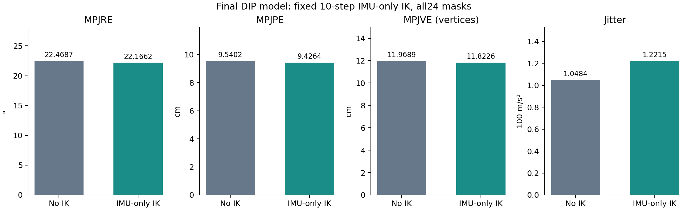

# IMU-only IK: final DIP model comparison

English presentation updated 2026-11-19; original experiment dates and bytes are preserved in [the language/provenance guide](../../RECORD_LANGUAGE.md).

Same final two-epoch weights, s09/s10,19 recordings, 24 masks.

| Metric | No IK | IMU-only IK | Relative decrease | Masks lower |
|---|---: |---: |---: |---: |
| MPJRE (°) | 22.46870 | 22.16620 | +1.35% | 24/24 |
| MPJPE (joints) (cm) | 9.54019 | 9.42636 | +1.19% | 24/24 |
| MPJVE (mesh vertices) (cm) | 11.96889 | 11.82258 | +1.22% | 24/24 |
| Jitter (100 m/s³) | 1.04836 | 1.22145 | -16.51% | 0/24 |

Positive means decrease, negative increase. Jitter describes smoothness; MPJVE always means mesh-vertex position error.

Ten Adam steps, lr 1e-3, orientation-matrix MSE; no GT constraints/calibration, weight changes or test tuning. Head/hip indices, learning rate and rotation parameterization are frozen reconstruction conventions, not a recovered line-by-line author implementation.

